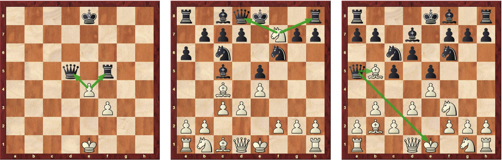

# **The Fork**

## What is a fork?

Definition: <u>A fork happens when a single piece threatens two or more enemy pieces at the same time.</u>

Let's see some examples!

## Your Turn!

Now that you understand the general mechanics of a fork, let's start the real lesson where you will be finding the fork positions yourself! 

### **Puzzle 1** (Hint: Bishop)

[Puzzle 1 Link](https://lichess.org/training/7hyLA)

Great Work! Now that you understand how to move your pieces into a fork position, let’s ramp it up a bit. This next puzzle takes place in an endgame position that requires 3 moves and the movement of multiple pieces. Good luck!

### **Puzzle 2**

Another midgame position for you. This one is a bit harder to find than the previous midgame puzzle. Let’s see how you do?

[Puzzle 2 Link](https://lichess.org/training/4UhmZ)

### **Puzzle 3**

Great work! You are really moving now! Now this one took me a little bit to figure out. You will now have to spot the sequence before the fork, not just spot the fork itself. Again, you will be required to move multiple pieces. Let’s see how you do? Remember, you can consult the hints feature if you are stuck. Best of luck!

[Puzzle 3 Link](https://lichess.org/training/01OKt)

### **Puzzle 4**

Let’s spice things up. This next puzzle takes place in the early game. How wonderful would it be to fork someone right when the game starts? This one is a bit of a challenge so I hope you are up for it. Good luck!

[Puzzle 4 Link](https://lichess.org/training/6z1K2)

### **Puzzle 5**

Let’s give you a taste of what the experts deal with. This is one of the hardest forks puzzles to solve. Do you have what it takes to complete the ultimate challenge?

[Puzzle 5 Link](https://lichess.org/training/09Uwe)

### **The Death Puzzle**

Let’s give you a taste of what the experts deal with. This is one of the hardest forks puzzles to solve. Do you have what it takes to complete the ultimate challenge?

[Death Puzzle Link](https://lichess.org/training/1gp2Z)

### Congradulations! I am proud and honored that you have completed my forks lesson. Remember to keep practicing and playing!